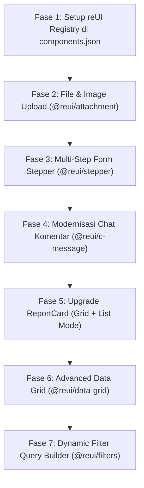

# Spesifikasi & Rencana Perombakan Komponen UI (reUI Migration Spec)

Dokumen ini merinci rencana refaktor dan modernisasi komponen antarmuka (*UI/UX*) pada **Sandaran Internal System** menggunakan ekosistem **reUI** (`https://reui.io`), sebuah *custom registry* untuk shadcn/ui berbasis Radix UI dan Tailwind CSS v4.

---

## 🎯 1. Latar Belakang & Tujuan

Aplikasi Sandaran Internal System saat ini telah memiliki fondasi solid dengan Next.js 15, Tailwind CSS v4, tRPC v11, dan TanStack Query v5. Namun, beberapa komponen antarmuka masih menggunakan implementasi manual/ad-hoc (misalnya file uploader custom ~12KB, data-table tanpa column pinning, dan form laporan panjang satu scroll).

Tujuan perombakan ini:
1. **Meningkatkan Mobile-First Experience**: Memastikan alur penginputan lapangan (oleh Mandor/Supervisor) sangat ergonomis, mendukung touch target minimal 44×44px, dan kamera HP langsung.
2. **Tampilan Enterprise yang Lebih Halus**: Mengganti komponen tabel dan card biasa dengan komponen berfitur lengkap (virtualization, sticky columns, pill filters, dan conversation bubbles).
3. **Mengurangi Technical Debt**: Mengganti ratusan baris kode manipulasi DOM custom dengan komponen resmi dari registry yang teruji aksesibilitasnya (*WCAG AA, Radix UI primitive*).

---

## ⚙️ 2. Persiapan & Konfigurasi Registry reUI

Proyek ini sudah menggunakan gaya `"style": "radix-nova"` pada [`components.json`](file:///d:/Haqqi%20Sukmara/NextJS/sandaran-internal-system/components.json). Untuk mengintegrasikan reUI, kita hanya perlu mendaftarkan registry reUI di blok `registries`.

```json
{
  "$schema": "https://ui.shadcn.com/schema.json",
  "style": "radix-nova",
  "rsc": true,
  "tsx": true,
  "tailwind": {
    "config": "",
    "css": "src/styles/globals.css",
    "baseColor": "zinc",
    "cssVariables": true,
    "prefix": ""
  },
  "iconLibrary": "tabler",
  "rtl": false,
  "aliases": {
    "components": "~/components",
    "utils": "~/lib/utils",
    "ui": "~/components/ui",
    "lib": "~/lib",
    "hooks": "~/hooks"
  },
  "menuColor": "default",
  "menuAccent": "subtle",
  "registries": {
    "@reui": "https://reui.io/r/{style}/{name}.json"
  }
}
```

---

## 🧩 3. Rencana Detail Perombakan Komponen

---

### 1. File & Image Upload (`@reui/attachment` / `@reui/file-upload`)

* **Target File Existing**:
  * [`src/components/shared/image-upload.tsx`](file:///d:/Haqqi%20Sukmara/NextJS/sandaran-internal-system/src/components/shared/image-upload.tsx)
  * [`src/components/shared/file-upload.tsx`](file:///d:/Haqqi%20Sukmara/NextJS/sandaran-internal-system/src/components/shared/file-upload.tsx)
  * [`src/components/report/media-upload.tsx`](file:///d:/Haqqi%20Sukmara/NextJS/sandaran-internal-system/src/components/report/media-upload.tsx)
  * Form terintegrasi: `report-form.tsx`, `deposit-form.tsx`, `withdraw-form.tsx`

* **Masalah Komponen Saat Ini**:
  * Kode buatan manual (~12KB) mengelola dropzone, preview thumbnail, tombol hapus, dan progress secara custom.
  * Input file `multiple` pada browser smartphone secara default mematikan direct camera trigger (hanya membuka galeri).
  * State preview dan error handling file belum terstandarisasi antar modul (berbeda antara upload report vs upload emergency).

* **Rancangan Baru dengan reUI**:
  * Menggunakan **`@reui/attachment`** yang menyediakan:
    * **File Chips / Cards**: Menampilkan thumbnail, nama file, ukuran file, ekstensi badge, dan progress bar animasi saat upload ke Cloudinary.
    * **Dual Action Picker**:
      1. Tombol **"Ambil Foto"** (menggunakan hidden input `capture="environment"` untuk langsung membuka kamera belakang HP).
      2. Tombol/Dropzone **"Pilih Dokumen / Galeri"** (mendukung multi-select file dari komputer/galeri).
    * **Image Preview Lightbox**: Zoom dan preview langsung terintegrasi.
    * **Atomic Cloudinary Lifecycle**: Tetap mempertahankan upload client-side ke Cloudinary saat submit/onDrop dan pembersihan public_id saat batal/hapus.

---

### 2. Tabel Data Lanjutan (`@reui/data-grid`)

* **Target File Existing**:
  * [`src/components/ui/data-table.tsx`](file:///d:/Haqqi%20Sukmara/NextJS/sandaran-internal-system/src/components/ui/data-table.tsx)
  * [`src/components/emergency/transaction-list.tsx`](file:///d:/Haqqi%20Sukmara/NextJS/sandaran-internal-system/src/components/emergency/transaction-list.tsx)
  * [`src/components/logistic/items-table.tsx`](file:///d:/Haqqi%20Sukmara/NextJS/sandaran-internal-system/src/components/logistic/items-table.tsx)
  * [`src/components/user/user-table.tsx`](file:///d:/Haqqi%20Sukmara/NextJS/sandaran-internal-system/src/components/user/user-table.tsx)
  * [`src/components/document/document-list.tsx`](file:///d:/Haqqi%20Sukmara/NextJS/sandaran-internal-system/src/components/document/document-list.tsx)

* **Masalah Komponen Saat Ini**:
  * Tabel bawaan saat ini mengalami overflow horizontal kaku di layar mobile/tablet.
  * Kolom aksi (*Action dropdown*) sering terpotong atau harus di-scroll jauh ke kanan.
  * Belum memiliki fitur *Column Pinning*, *Column Resizing*, atau *Density Toggle*.

* **Rancangan Baru dengan reUI**:
  * Mengintegrasikan **`@reui/data-grid`** (TanStack Table + Virtualized):
    * **Column Pinning**: Kolom **"Nama Item / Transaksi"** di-pin di kiri, dan kolom **"Aksi"** di-pin di kanan (*sticky*), sehingga saat user men-scroll tabel di layar smartphone, tombol aksi dan identitas baris tidak hilang.
    * **Density Switcher**: User bisa beralih antara mode *Compact* (cocok untuk audit banyak angka di Finance/Logistik) dan mode *Normal/Relaxed*.
    * **Quick Filter & Search Bar Bawaan**: Input pencarian real-time terintegrasi di atas header tabel.
    * **Export Action**: Opsi download CSV/Excel bawaan dari data grid.

---

### 3. Multi-Step Form Stepper (`@reui/stepper`)

* **Target File Existing**:
  * [`src/components/report/report-form.tsx`](file:///d:/Haqqi%20Sukmara/NextJS/sandaran-internal-system/src/components/report/report-form.tsx)
  * [`src/components/project/project-form.tsx`](file:///d:/Haqqi%20Sukmara/NextJS/sandaran-internal-system/src/components/project/project-form.tsx)

* **Masalah Komponen Saat Ini**:
  * Form Laporan Harian sangat panjang ke bawah: Tanggal ➔ Cuaca ➔ Lokasi ➔ Jumlah Pekerja ➔ Deskripsi Pekerjaan ➔ Rincian Tugas ➔ Dokumentasi Foto ➔ Kendala.
  * Mengisi form sepanjang ini di HP di bawah sinar matahari lapangan sangat melelahkan dan rentan terlewat field wajibnya.

* **Rancangan Baru dengan reUI**:
  * Menggunakan **`@reui/stepper`** untuk membagi pengisian form menjadi **3 Langkah Terstruktur**:
    * **Langkah 1: Kondisi Lapangan**
      * Tanggal Laporan (WITA timezone)
      * Lokasi Kerja / Area
      * Kondisi Cuaca (Cerah, Mendung, Hujan, Custom)
      * Jumlah Total Pekerja
    * **Langkah 2: Progres & Rincian Tugas**
      * Deskripsi Umum Pekerjaan
      * Persentase Progres Hari Ini
      * Checklist / Rincian Sub-tugas
    * **Langkah 3: Dokumentasi & Kendala**
      * Upload Foto Dokumentasi (Kamera HP / Galeri)
      * Catatan Kendala Lapangan (*Issues / Blockers*)
  * **UX Stepper**: Indikator langkah di atas form dengan nomor/icon, tombol "Kembali" dan "Lanjutkan", serta validasi Zod per tahap sebelum user melangkah ke tahap berikutnya.

---

### 4. Komponen Baris & Feed List (`@reui/item`)

* **Target File Existing**:
  * [`src/components/report/task-item.tsx`](file:///d:/Haqqi%20Sukmara/NextJS/sandaran-internal-system/src/components/report/task-item.tsx)
  * [`src/components/project/project-members-list.tsx`](file:///d:/Haqqi%20Sukmara/NextJS/sandaran-internal-system/src/components/project/project-members-list.tsx)
  * List transaksi terbaru dan laporan terbaru pada dashboard ([`dashboard-client.tsx`](file:///d:/Haqqi%20Sukmara/NextJS/sandaran-internal-system/src/app/(internal)/dashboard/dashboard-client.tsx))

* **Masalah Komponen Saat Ini**:
  * Setiap list item dibuat menggunakan custom `div` flexbox manual dengan padding dan margin yang bervariasi.
  * Sebagian touch target tombol aksi di baris terlalu kecil (< 40px), melanggar aturan mobile-first.

* **Rancangan Baru dengan reUI**:
  * Menggunakan **`@reui/item`**:
    * Struktur baku yang konsisten:
      * `ItemLeading`: Avatar user / icon status transaksi.
      * `ItemContent`: Judul tebal, baris kedua untuk deskripsi/tugas, dan baris ketiga untuk timestamp/meta.
      * `ItemTrailing`: Badge status, progress pill, dan tombol aksi (*action button/dropdown*) dengan ukuran min. 44×44px.
    * Efek hover dan active yang konsisten (`active:scale-98`, `hover:bg-muted/50`).

---

### 5. Filter Query Builder (`@reui/filters`)

* **Target File Existing**:
  * Filter di halaman Laporan ([`reports-client.tsx`](file:///d:/Haqqi%20Sukmara/NextJS/sandaran-internal-system/src/app/(internal)/projects/[slug]/reports/reports-client.tsx))
  * Filter Logistik ([`logistic-client.tsx`](file:///d:/Haqqi%20Sukmara/NextJS/sandaran-internal-system/src/app/(internal)/projects/[slug]/logistics/logistic-client.tsx))
  * Filter Emergency Fund ([`emergency-client.tsx`](file:///d:/Haqqi%20Sukmara/NextJS/sandaran-internal-system/src/app/(internal)/projects/[slug]/emergency/emergency-client.tsx))

* **Masalah Komponen Saat Ini**:
  * Filter saat ini berupa 2–3 dropdown `<Select>` biasa yang memakan ruang horizontal dan tidak memiliki visual chip / badge filter aktif.

* **Rancangan Baru dengan reUI**:
  * Menggunakan **`@reui/filters`**:
    * Desain berbasis *Filter Bar + Active Tags* (mirip Notion/Linear).
    * User dapat mengklik "+ Tambah Filter", memilih atribut (misal: "Status = UNREVIEWED", "Tanggal = Minggu Ini", "Kategori = Dana Keluar").
    * Filter aktif muncul sebagai tag pill yang bisa di-dismiss satu per satu atau dengan satu tombol "Reset Filter".

---

### 6. Percakapan & Komentar Laporan (`@reui/c-message-*`)

* **Target File Existing**:
  * [`src/components/comment/comment-list.tsx`](file:///d:/Haqqi%20Sukmara/NextJS/sandaran-internal-system/src/components/comment/comment-list.tsx)
  * [`src/components/comment/comment-item.tsx`](file:///d:/Haqqi%20Sukmara/NextJS/sandaran-internal-system/src/components/comment/comment-item.tsx)
  * [`src/components/comment/comment-form.tsx`](file:///d:/Haqqi%20Sukmara/NextJS/sandaran-internal-system/src/components/comment/comment-form.tsx)

* **Masalah Komponen Saat Ini**:
  * Chat bubble saat ini dibuat secara manual dengan styling custom `bg-primary` dan `bg-muted`.
  * Belum ada fitur pengelompokan pesan berurutan (*message run/grouping*), avatar bersusun, atau aksi cepat (reply/copy).

* **Rancangan Baru dengan reUI**:
  * Mengadopsi pola **`@reui/c-message-1`** (Two-sided conversation):
    * **Pesan Sendiri (Kanan)**: Balon chat warna `primary` dengan sudut kurva modern (`rounded-2xl rounded-br-xs`), avatar mini di kanan, dan indikator waktu yang lembut.
    * **Pesan Rekan Tim / Stakeholder (Kiri)**: Balon chat `muted/80 border`, avatar di kiri, lengkap dengan badge role (`ADMIN`, `ARCHITECT`, `FINANCE`).
    * **Message Actions**: Tombol hapus dan konfirmasi delete dialog yang rapi dan tidak mengganggu saat di-hover/tap.

---

### 7. Evaluasi & Rencana Upgrade `ReportCard` ([`src/components/report/report-card.tsx`](file:///d:/Haqqi%20Sukmara/NextJS/sandaran-internal-system/src/components/report/report-card.tsx))

#### 🧐 7.1 Analisis Desain & Evaluasi
* **Kelebihan Saat Ini**:
  * Konsep visual saat ini (**Layered Cover**: media cover 16:9 di layer belakang dengan floating Card informasi yang bertumpuk `-mt-6 sm:-mt-8`) **sangat unik, berkarakter, dan cocok untuk kartu proyek konstruksi**. Desain ini terasa premium dan lebih hidup dibanding kartu flat biasa.
* **Kelemahan & Area yang Perlu Dirombak**:
  1. **Dead Code**: Terdapat blok kode lama sepanjang 58 baris (baris 70–128) yang masih di-comment out di dalam komponen.
  2. **Kurang Indikator Galeri**: Media thumbnail hanya menampilkan foto pertama (`report.media[0]`). Pengguna tidak menyadari ada banyak foto dokumentasi di dalam laporan jika tidak melihat icon kecil di footer.
  3. **Scroll Fatigue di Mobile**: Saat sebuah proyek memiliki 30+ laporan harian, kartu cover foto berukuran besar memakan terlalu banyak vertikal scroll di layar smartphone.

---

#### 📸 7.2 Ketentuan Spesifik: Badge Jumlah Foto (Photo Count Badge Overlay)

Badge jumlah foto berfungsi memberi sinyal visual langsung kepada pengguna bahwa laporan tersebut memiliki lampiran dokumentasi foto lapangan:

1. **Posisi & Penempatan**:
   * Diletakkan di **pojok kiri atas cover media** (`absolute top-3 left-3 z-10`).
   * Posisi ini simetris dan seimbang dengan **Badge Cuaca** yang berada di **pojok kanan atas** (`absolute top-3 right-3 z-10`).
2. **Kondisi Tampil & Format Teks**:
   * **Jika `report.media.length > 1`**: Tampilkan badge chip berisi icon foto + total jumlah foto.
     * Format: `📸 {report.media.length} Foto` (Contoh: `4 Foto` atau `+3 Foto`).
   * **Jika `report.media.length === 1`**: Tampilkan badge netral `📸 1 Foto` atau cukup cover image tanpa badge angka agar tidak bising visual.
   * **Jika `report.media.length === 0`**: Tampilkan fallback visual ilustrasi kosong (`IconPhotoOff` / placeholder pattern) tanpa badge foto.
3. **Styling & Estetika**:
   * Menggunakan *glassmorphism badge* dengan kontras tinggi di atas foto apapun:
     ```tsx
     className="flex items-center gap-1.5 rounded-full border border-white/20 bg-black/60 px-2.5 py-1 text-xs font-medium text-white shadow-sm backdrop-blur-md transition-transform group-hover:scale-105"
     ```
   * Efek hover: Badge sedikit bereaksi (`scale-105`) saat kartu di-hover untuk mempertegas interaktivitas.

---

#### 🔀 7.3 Ketentuan Spesifik: Mode Grid / List View (Dual-View Architecture)

Halaman daftar laporan proyek ([`reports-client.tsx`](file:///d:/Haqqi%20Sukmara/NextJS/sandaran-internal-system/src/app/(internal)/projects/[slug]/reports/reports-client.tsx)) akan mendukung dua mode tampilan yang dapat diganti secara instan oleh pengguna:

```
[ Toolbar: Search Input | Filter Button | View Toggle: [ ⊞ Grid | ☰ List ] | + Buat Laporan ]
```

##### A. Mekanisme & State Persistensi:
* **Komponen Kontrol**: Menggunakan segmented toggle / `ToggleGroup` shadcn di header toolbar laporan.
* **Tipe State**: `viewMode: "grid" | "list"`.
* **Persistensi Preferensi**: Disimpan di `localStorage` (key: `sandaran_reports_view_mode`) sehingga preferensi user tetap tersimpan saat navigasi antar proyek atau reload halaman.
* **Default View**:
  * Desktop (≥ 768px): Default `grid`.
  * Mobile (< 768px): Mendukung keduanya dengan mulus (user bebas memilih).

##### B. Spesifikasi Mode Grid (`ReportCard.tsx`):
* Menggunakan arsitektur *Layered Cover Card* yang disempurnakan:
  * Layer belakang: Gambar 16:9 + Badge Jumlah Foto (kiri atas) + Badge Cuaca (kanan atas).
  * Layer depan: Floating card elevasi tinggi (`-mt-6 sm:-mt-8`) dengan avatar pelapor, tanggal laporan, deskripsi tugas (2 baris truncate), persentase progress bar, dan statistik footer.
  * Layout grid: `grid grid-cols-1 md:grid-cols-2 xl:grid-cols-3 gap-6`.

##### C. Spesifikasi Mode List (`ReportListItem.tsx` berbasis `@reui/item`):
Mode list dirancang khusus untuk scanning data cepat (*dense audit view*) bagi Executive atau Supervisor:
* Menggunakan komponen **`@reui/item`** dengan layout baris horizontal:
  * **Leading (Kiri)**:
    * Thumbnail foto mini berbentuk rounded-lg (ukuran 48×48px atau 56×56px) dengan badge angka foto mini di pojoknya.
    * Avatar mandor/pembuat laporan + tanggal format WITA (`dd MMM yyyy`).
  * **Content (Tengah)**:
    * Baris 1: Judul / Nama Pelapor + Badge Cuaca mini (`IconSun` / `IconCloudRain`).
    * Baris 2: Potongan deskripsi pekerjaan (`line-clamp-1` di HP, `line-clamp-2` di desktop).
    * Baris 3: Meta info singkat (`N pekerja` • `N tugas` • `N komentar`).
  * **Trailing (Kanan)**:
    * Badge pill progres persentase dengan *color coding*:
      * `≥ 75%`: Hijau emerald / sukses
      * `25% - 74%`: Biru langit / primary
      * `< 25%`: Kuning amber / warning
    * Chevron icon panah kanan (`IconChevronRight`) dengan touch target min 44×44px.
* Efek Interaksi: Hover background `hover:bg-muted/60`, active state `active:scale-[0.99]`, dan transisi mulus.

---

#### 📐 7.4 Tipe Props & Arsitektur Kode Baru

```typescript
// src/components/report/types.ts
export type ReportViewMode = "grid" | "list";

export interface ReportItemData {
  id: string;
  slug: string;
  reportDate: Date | string;
  taskDescription: string;
  progressPercent: number;
  weather?: string | null;
  totalWorkers: number;
  user: { name: string; image?: string | null };
  media: Array<{
    id: string;
    url: string;
    publicId: string;
  }>;
  tasks: unknown[];
  _count?: { comments: number };
}

export interface ReportCardProps {
  report: ReportItemData;
  projectSlug: string;
}

export interface ReportListItemProps {
  report: ReportItemData;
  projectSlug: string;
}
```

---

#### 🖼️ 7.5 Visual Comparison Mockup

```
========================================================================
MODE GRID (Layered Cover Card):
+----------------------------------------------------------------------+
| [📸 4 Foto]                                       [☀️ Cerah Berawan] |
|                                                                      |
|                     [ COVER IMAGE 16:9 ]                             |
|                                                                      |
|   +--------------------------------------------------------------+   |
|   | (Avatar) Mandor Wayan                   14 Okt 2026          |   |
|   | Pengecoran plat lantai 2 zona barat selesai 100%...          |   |
|   | Progres: [====================       ] 75%                   |   |
|   | 18 pekerja                     📸 4 Foto       💬 2 Komentar |   |
|   +--------------------------------------------------------------+   |
+----------------------------------------------------------------------+

========================================================================
MODE LIST (@reui/item Baris Horizontal):
+----------------------------------------------------------------------+
| [Img 48px]  (Avatar) Wayan • 14 Okt 2026 [☀️ Cerah]   [ 75% ]    >  |
|             Pengecoran plat lantai 2... • 18 pekerja • 💬 2          |
+----------------------------------------------------------------------+
| [Img 48px]  (Avatar) Ketut • 13 Okt 2026 [🌧️ Hujan]   [ 50% ]    >  |
|             Pemasangan bekisting kolom... • 14 pekerja • 💬 0        |
+----------------------------------------------------------------------+
```

---

## 🗺️ 4. Roadmap & Urutan Implementasi

Berikut adalah urutan kerja bertahap (*phase-by-phase*) yang direkomendasikan agar tidak memutus fungsionalitas yang sedang berjalan:



### Rincian Fase:
1. **Fase 1: Konfigurasi Dasar**
   * Tambahkan `@reui` registry ke `components.json`.
   * Jalankan tes instalasi komponen pertama.
2. **Fase 2: Perombakan File & Media Upload**
   * Install `@reui/attachment`.
   * Implementasikan dual-action picker (Kamera HP langsung + Galeri).
   * Hubungkan dengan atomic Cloudinary upload di form report dan emergency fund.
3. **Fase 3: Multi-Step Form Stepper pada Laporan**
   * Install `@reui/stepper`.
   * Bagi `report-form.tsx` menjadi 3 langkah wizard.
4. **Fase 4: Komentar Laporan**
   * Install pola `@reui/c-message`.
   * Perbarui tampilan balon chat di `comment-list.tsx` & `comment-item.tsx`.
5. **Fase 5: Pemolesan ReportCard & List View Toggle**
   * Bersihkan dead code di `report-card.tsx` dan tambahkan media count badge overlay.
   * Buat varian baris list (`report-list-item.tsx`) menggunakan `@reui/item`.
6. **Fase 6: Advanced Data Grid**
   * Install `@reui/data-grid`.
   * Terapkan column pinning untuk tabel emergency fund dan logistik.
7. **Fase 7: Filter Query Builder**
   * Pasang `@reui/filters` untuk filtering dinamis berbasis tag pill.

---

## 🧪 5. Kriteria Keberhasilan & Testing Matrix

Setiap komponen yang telah dirombak harus memenuhi standar:
1. **TypeScript Strict**: `pnpm typecheck` lulus 100% tanpa type error.
2. **Biome Linter**: `pnpm biome check` lulus tanpa error atau warning.
3. **Mobile Accessibility**:
   * Minimum touch target 44×44px (`min-h-11 min-w-11`).
   * Kamera HP terbuka langsung saat opsi ambil foto ditekan di mobile Safari/Chrome.
4. **Theme Support**: Kontras WCAG AA (min 4.5:1) di Light Mode maupun Dark Mode.
5. **Zero Regression**: Semua operasi simpan, edit, hapus, dan validasi Zod tetap berjalan normal seperti sebelumnya.
