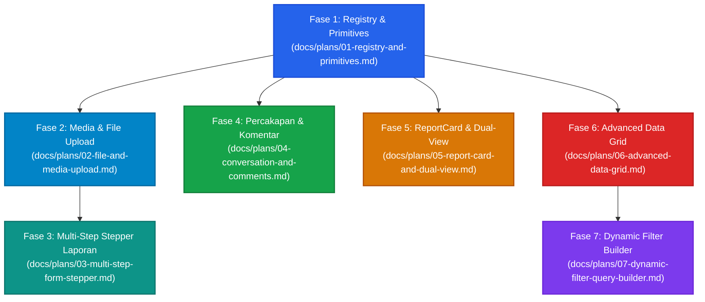

# 📋 Master Implementation Plan: UI Component Revamp (reUI Migration)

> **Dokumen Induk Pengeksekusian Modular untuk Revamp Komponen UI Sandaran Internal System**  
> Mengacu pada spesifikasi lengkap di [`docs/COMPONENT-REVAMP-SPEC.md`](file:///d:/Haqqi%20Sukmara/NextJS/sandaran-internal-system/docs/COMPONENT-REVAMP-SPEC.md).

---

## 🎯 1. Ringkasan & Prinsip Eksekusi

Rencana implementasi ini memecah perombakan UI besar menjadi **7 fase modular terisolasi**. Setiap fase memiliki file rencana teknis mandiri di dalam folder `docs/plans/`, sehingga eksekusi dapat dilakukan secara bertahap tanpa menimbulkan regresi pada modul lain.

### 🛡️ Guardrails Utama (Aturan Wajib):
1. **Zero Regression**: Semua operasi CRUD (create, update, delete) dan validasi Zod yang sudah berjalan di production tidak boleh terganggu.
2. **Mobile-First Touch Target**: Semua elemen interaktif wajib memiliki touch target minimum **44×44px** (`min-h-11 min-w-11` di layar mobile, atau `p-2.5` dengan touch padding).
3. **TypeScript & Biome Clean**: Setiap selesai satu fase, wajib lulus:
   - `pnpm typecheck` (0 errors)
   - `pnpm biome check` (0 errors, 0 warnings)
4. **No Ad-Hoc Styling**: Menggunakan design tokens yang telah disepakati di [`docs/DESIGN-SYSTEM.md`](file:///d:/Haqqi%20Sukmara/NextJS/sandaran-internal-system/docs/DESIGN-SYSTEM.md) dan Tailwind CSS v4 variables.
5. **Atomic Cloudinary Lifecycle**: Upload foto langsung dari klien dengan signed params tRPC, disertai pembersihan `public_id` saat batal/hapus.

---

## 🗺️ 2. Peta Dependensi & Alur Eksekusi



---

## 📊 3. Matriks Modul & Status Eksekusi

| Fase | Modul & Dokumen Rencana | Komponen Primitif | Area Terdampak | Status |
| :---: | :--- | :--- | :--- | :---: |
| **01** | [`01-registry-and-primitives.md`](file:///d:/Haqqi%20Sukmara/NextJS/sandaran-internal-system/docs/plans/01-registry-and-primitives.md) | `@reui` config, `stepper`, `item`, `bubble`, `message` | `components.json`, `src/components/ui/*` | 🟢 Selesai (Completed) |
| **02** | [`02-file-and-media-upload.md`](file:///d:/Haqqi%20Sukmara/NextJS/sandaran-internal-system/docs/plans/02-file-and-media-upload.md) | `@reui/attachment` / `file-upload` | `image-upload.tsx`, `file-upload.tsx`, `media-upload.tsx`, `deposit-form.tsx`, `withdraw-form.tsx` | 🟢 Selesai (Completed) |
| **03** | [`03-multi-step-form-stepper.md`](file:///d:/Haqqi%20Sukmara/NextJS/sandaran-internal-system/docs/plans/03-multi-step-form-stepper.md) | `@reui/stepper` | `report-form.tsx`, `report-dialog.tsx` | 🟢 Selesai (Completed) |
| **04** | [`04-conversation-and-comments.md`](file:///d:/Haqqi%20Sukmara/NextJS/sandaran-internal-system/docs/plans/04-conversation-and-comments.md) | `@reui/c-message-*`, `bubble`, `message` | `comment-list.tsx`, `comment-item.tsx`, `comment-form.tsx` | 🟢 Selesai (Completed) |
| **05** | [`05-report-card-and-dual-view.md`](file:///d:/Haqqi%20Sukmara/NextJS/sandaran-internal-system/docs/plans/05-report-card-and-dual-view.md) | `@reui/item`, `toggle-group` | `report-card.tsx`, `report-list-item.tsx`, `report-list.tsx`, `reports-client.tsx` | 🟡 Siap Eksekusi |
| **06** | [`06-advanced-data-grid.md`](file:///d:/Haqqi%20Sukmara/NextJS/sandaran-internal-system/docs/plans/06-advanced-data-grid.md) | `@reui/data-grid`, TanStack Virtual | `transaction-list.tsx`, `items-table.tsx`, `user-table.tsx`, `document-list.tsx` | 🟡 Siap Eksekusi |
| **07** | [`07-dynamic-filter-query-builder.md`](file:///d:/Haqqi%20Sukmara/NextJS/sandaran-internal-system/docs/plans/07-dynamic-filter-query-builder.md) | `@reui/filters` | `reports-client.tsx`, `logistic-client.tsx`, `emergency-client.tsx` | ⚪ Menunggu Fase 6 |

---

## ⚙️ 4. Standar Verifikasi Setiap Fase

Setiap kali menyelesaikan pengerjaan pada salah satu fase di atas, jalankan rangkaian uji berikut:

```bash
# 1. Validasi Type Safety (Wajib 0 error)
pnpm typecheck

# 2. Validasi Kode & Formatter (Wajib 0 error / warning)
pnpm biome check

# 3. Validasi Smoke Test Fitur Terkait
# Buka rute halaman di browser desktop & mobile devtools (iPhone 14 / Pixel 7 view)
```

---

## 🧭 5. Cara Menggunakan Dokumen Ini

1. **Pilih Fase**: Kerjakan sesuai urutan dependensi graf di atas (mulai dari `01-registry-and-primitives.md`).
2. **Buka Rencana Spesifik**: Setiap file fase berisi:
   - File target yang diubah / dibuat
   - Masalah spesifik yang diselesaikan
   - Kode antarmuka (TypeScript interfaces & schema)
   - Spesifikasi Mobile Touch & Responsive
   - Checklist verifikasi step-by-step
3. **Eksekusi & Checklist**: Centang checklist setelah kode diverifikasi dengan `pnpm typecheck` dan `pnpm biome check`.
